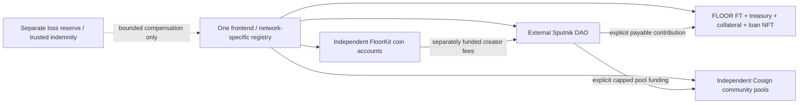

# Floorline V4 architecture and release decision

## Executive decision

Select architecture B: one FLOOR contract owns the treasury, FT ledger, loan
collateral and recovery-right NFT ledger. Deploy Cosign separately per community,
FloorKit separately per coin, and retain external Sputnik governance. Sharing
reviewed Rust libraries is desirable; sharing native reserves is not.

**NO-GO for mainnet.** This is an architecture selection with incomplete proof,
not a new cleared release candidate. Unknown-transfer recovery remains blocked.
No mainnet, public-testnet, website or production-key mutation is authorized or
performed. V1/V2/V3 and FloorKit historical evidence remain unchanged.

## Architecture comparison and physical boundary

| Option | Consistency and atomicity | Isolation and authority | Cost / receipts / audit | Decision |
|---|---|---|---|---|
| A all products together | local state transitions atomic | all reserves and upgrades share failure domain | one code stake, largest reachable state/audit surface | reject |
| B FLOOR + loans/NFT; others separate | ownership and collateral settlement local | unrelated credit/creator risk isolated by accounts | moderate code stake; asynchronous bridges only | select |
| C separate loan/NFT from FLOOR | escrow requires receipt-based handshake | treasury code separated, token custody more complex | extra deployments, callbacks, indexing and audit | runner-up only with a proven custody protocol |
| D split every ledger/vault | many partial commits and pending locks | more keys and upgrade dependencies | highest code/storage/receipt overhead | reject for first release |
| E B plus separately funded indemnity | normal settlement unchanged | uncertainty losses limited to indemnity capital | explicit trusted claims process and separate audit | conditional future addition |

Separate accounts protect against accidental direct ledger access, not malicious
authorized transfers, FullAccess keys, unsafe upgrades or shared dependency bugs.
Cross-contract calls have no distributed rollback. Every bridge needs an immutable
recipient, purpose, nonce, amount and independently reserved sender funds.

The NFT must stay with collateral settlement. In the integrated state machine,
repayment checks current owner, debt, expiry and pending count and changes the
terminal loan state plus collateral balance in one receipt. A split read-owner
then-release design admits: read Alice; transfer NFT to Bob; callback releases
collateral to Alice using stale owner. A safe split requires authoritative remote
lock-and-version, immutable beneficiary, abort/commit states and recovery for
lost lock/commit receipts. Separation alone supplies none of these. This
counterexample is reasoning, not a claimed executed split-contract exploit.

## FLOOR financial specification

All money is integer yoctoNEAR; token units are 10^24 per FLOOR. Preserve the
checked U512 quote with one final integer division:

`q = floor(L*c*((10000-tax)*T + tax*c)/(10000*T*T))`.

For `0<c<T`, q*T <= L*c, hence `(L-q)/(T-c) >= L/T`. Full exit pays L, leaving
L=T=0. FLOOR permits restart; FloorKit permanent closure is a different policy.
Backing L/T is undefined at zero supply and is neither market price nor a
constant minimum executable redemption. Dust q=0 rejects without burning.

Fixed issuance m=floor(d*weight_num/weight_den) admits positive m only when
T=0 or d*T>=L*m. Contributions increase L without minting while T>0. FT and
NFT movements do not change backing. Locked collateral is included once in T.
Use min_tokens/min_out and a proposed execution deadline for transaction review;
deadline addition is a new ABI change, not available in the approved deployment.

Registration must separately prepay maximum serialized record costs. Native
claims replace backing/escrow liabilities before dispatch. Unexplained direct
deposits are unallocated, never automatically assigned to L. No administrator
mint, backing withdrawal or cross-product lending route is permitted.

Future caps must cover gross issuance, contributions, offer principal, repayments
and bounded storage admission separately. A gross counter never resets after
withdrawal. A guardian may stop new risk only, not repayments, defaults, funded
withdrawals or record cleanup. Economic cap values require an approved budget;
V3's 100/1000 NEAR figures are illustrative and not release limits.

## Loan and NFT specification

Offer funding adds principal to unused lender escrow, never L. Cancellation is
exclusive with acceptance and creates a funded lender claim. Acceptance debits
borrower available FLOOR, credits locked custody, creates principal claim, mints
the recovery NFT, sets expiry=block_time+duration with checked overflow, and moves
offer to Active atomically. Borrower payout failure does not extend expiry;
the UI must disclose this or a new activation policy must be independently gated.

Only current NFT owner may repay exact debt before expiry. At expiry equality,
repayment rejects and permissionless default transfers collateral to lender.
Either terminal transition burns the NFT and prevents repeated settlement.
Transfer-call increments pending count; settlement waits for all resolutions.
Forwarding may change owner, so a resolver may revert only if its recorded
receiver still owns the NFT. Lost resolver can freeze that loan; this remains a
separate liveness blocker. Approvals are optional NEP-178 scope and not present
in v1; do not advertise them. Index loan/claim IDs from events with an indexer
watermark. Paid/closed records can be cleaned only after referenced rights end;
abandoned live rights cannot be silently deleted.

## FloorKit design and sequencing

Use one account/reserve/NEP-141 namespace per coin. A shared factory ledger does
not itself provide distinct standard FT identities or account-level isolation.
Factory fee funds factory costs, not coin backing. Deploy exact hash and initialize
atomically with separately declared seed, user storage and operations budgets.
Failure before initialization must leave a recoverable factory-funded creation
record; account creation retries require idempotent names and verified code/state.

No global-contract cost saving is assumed before protocol and code-reference
verification. Keyless claims require account key inspection and reachable code
action review, not merely absence of an exported upgrade method. A mutable factory
must not gain authority over previously frozen children.

For gross purchase d, fee f=floor(d*fee_bps/10000), net n=d-f and markup mu:
`m=floor(n*T*10000/(R*(10000+mu)))`; set R'=R+n,T'=T+m,F'=F+f.
Then m*R<=n*T proves backing nondilution. Fee extraction from old R is forbidden.
Use the FLOOR-shaped redemption curve with coin-specific bounded tax. Full exit
sets R=T=0 and permanently closes that coin. Creator fee F remains separate.
Metadata size, account IDs and fees must be bounded; cap coin creation and charge
actual storage to creators. No creator legitimacy or profitability certification.

Historical FloorKit eight-slot unknown refund saturation remains BLOCKED. Larger
capacity only delays saturation. Develop FloorKit after the FLOOR recovery gate;
do not launch a factory around the blocked artifact.

## Cosign Circles financial and trust model

Use a standalone pool per community, no FLOOR minting and no FloorKit reserves.
Store member activation time, finalized reputation, per-member debt/exposure,
request version, due date, grace end, principal/debt paid, and bounded voucher
stake list. DAO changes membership with waiting period; snapshot eligibility at
acceptance. Two distinct account IDs are not proof of two independent people.
Reject self-vouch and direct reciprocal active guarantees; graph heuristics cannot
prove absence of collusion. Cap vouchers per request and outstanding requests.

Initially use zero interest to avoid unfunded interest expectations. Principal P
is actual finalized pool cash. Guarantee G>=ceil(P/2) is additional voucher cash,
never pool liquidity and never counted twice. At 60% utilization of equity E,
outstanding principal <=0.6E; correlated total default with collectible G=0.5P
loses <=0.5P<=0.3E, before operational losses. This is not full collateralization.
If guarantees are inaccessible or payout outcomes unknown, recoverable G may be
zero and losses can reach 0.6E. A colluding borrower+vouchers group can net P-G;
two vouchers do not eliminate this incentive.

Allocate repayments to outstanding principal first, then release voucher stakes
proportionally only on finalized repayments. Partial repayment p leaves shortfall
D=P-p. At default slash min(G,D), return excess stake pro-rata with deterministic
integer remainder rule, and recognize loss max(0,D-G). Never book expected debt
as immediately withdrawable native cash. No lender on-demand full-value withdrawal
promise against illiquid/undercollateralized receivables. Reputation updates only
from terminal finalized results; compensation does not count as borrower repayment.

Extensions and forgiveness require DAO proposal with request version, bounded
duration and explicit loss recognition; cannot release locked guarantees without
accounting for the resulting shortfall. Freeze new lending/vouches on incident,
not actual repayment or funded exits. Membership, parameter and governance abuse
remain credit trust. This is design only; no Cosign implementation or independent
Grok proposal file was found by repository filename search.

## Sputnik bridge and authority

Retain actual Sputnik proposal/policy model. Historical project DAO is version
2.3.1 with a three-account council and two approvals, 1 NEAR proposal bond and
seven-day period. All three keys are operator controlled: independent human
governance is unproven. Its historical successful 0.1 NEAR contribution is not
new V4 execution evidence.

Proposed interfaces: FLOOR `contribute({})` payable; Cosign
`fund_pool({allocation_id,expected_version})` payable and idempotent; FloorKit
creator fee claim to immutable configured DAO beneficiary. Reject wrong receiver,
duplicate allocation IDs and parameter mismatches before booking liability.
Attached deposit is booked only inside the recipient's successful receipt.
Sender proposal approval is not transfer completion. Record root and every child
receipt, bond refunds separately, and monitor code/policy changes. DAO must have
no FLOOR backing-spend capability. Cosign governance may spend its explicitly
donated pool capital only under pool rules; generic contract action dispatch is
not granted. Malicious DAO upgrades/recipient policy are audit boundaries.

## Root payout decision

| Architecture | Final native action and missing-result effect | Authority / availability |
|---|---|---|
| direct transfer+callback | wallet Transfer; callback failure leaves InFlight | no safe timeout retry |
| pull claim | claim owner triggers same final Transfer | timing control, same ambiguity |
| dedicated vault | vault triggers same final Transfer | isolates accounting, adds bridge/key risk |
| receiver escrow | delivery to escrow may be idempotent; wallet exit still Transfer | moves final problem |
| authenticated receipt proof | verify outcome plus canonical finality/root and attempt provenance | possible research direction; verifier not implemented/proven here |
| restricted attestations | council reports outcome; contract cannot independently authenticate report | trust may misclassify or censor |
| isolated indemnity | new payment from separately funded loss reserve | finite compensation, not original settlement proof |

Common states: Available -> dispatch/attempt -> InFlight -> callback Success/Paid
or Failure/RefundPending. Successful transfer with failed callback and failed
transfer with failed callback both leave InFlight. Subsequent account balance is
not a proof because unrelated deposits/refunds can produce the same observation.
NEAR schedules callbacks, but their code can fail/OOG without updating state;
this is not evidence that the protocol arbitrarily drops finalized transfers.

No permissionless historical-outcome query is implemented in these contracts.
Ordinary RPC JSON and user acknowledgement provide no authenticated fact.
Light-client receipt proofs require verified headers, canonical outcome root,
Merkle path, receipt identity and attempt binding; declaring them impossible at
the protocol level would be stronger than the evidence supports. Their gas,
security and trust-bootstrap feasibility remains UNPROVEN here.

The narrowest acceptable trusted fallback is a separately capitalized indemnity
pool, immutable beneficiaries, per-claim/epoch caps, threshold approvals, evidence
commitments, public challenge delay and appeal process. It must never restore an
unknown claim against customer backing. A mistaken approval can pay extra from
indemnity; this is an explicitly allocated insurer loss. Late original payment
may still cause total beneficiary receipts >original claim, so strict no-double-
receipt guarantees are not met. Recovery is conditional on reserve/committee
availability; operators/indexers offline means delayed compensation. No such
committee or insurance capital is established in this task.

## Economic invariant matrix

| Domain | Required conservation / availability condition |
|---|---|
| FLOOR | T=sum(free balances)+locked; L exclusive backing |
| loan | principal: unused escrow -> borrower claim; exact repayment funds lender claim; collateral unchanged in total T |
| each coin | A>=R+F+storage+operations+available claims, after pending debit treatment; no coin shares R |
| Cosign | equity = cash+conservatively valued receivables-loss provisions; spendable cash excludes voucher stake/storage/claims |
| vouchers | deposited = locked+available return claims+finalized slash allocations+settled withdrawals |
| DAO | native available excludes storage, bonds and committed outgoing promises |
| storage/operations | account cash retained covers actual stake and booked refundable balances; no backing subsidy |
| payouts | each claim has one active attempt; unknown never recredited from time or balance inference |
| indemnity | paid+committed compensation <=separately deposited loss capital; no recourse to other modules |

Across accounts, record transfer as sender commitment until final debit and as
recipient spendable only after its receipt. Never sum a sender's pre-debit cash
with recipient's future credit as two assets. An aggregate dashboard must show
pending bridges separately. Debt and funding promises are not native NEAR.

## Threat matrix

| Attack path | Affected asset | Defense / residual |
|---|---|---|
| holder front-runs quote | redemption proceeds | min_out/deadline; ordering still matters |
| borrower defaults/colludes | lender collateral / Cosign equity | atomic default; bounded credit losses, no social identity proof |
| malicious receiver forwards or burns gas | FT/NFT rights | pending-version rules; callback liveness remains |
| fake creator / child initialization capture | coin funds | bounded metadata, atomic init/hash registry; creator reputation off-chain |
| council collusion / FullAccess compromise | governed account's full balance | independent custody, constrained interfaces, audit; keys can bypass code |
| stale remote owner / replay evidence | collateral / payout | local NFT settlement; exact attempt/version/nonces |
| callback OOG / partition / RPC disagreement | availability | quarantine, raw receipts, no auto retry; unresolved rights may remain locked |
| storage spam / abandoned rights | operational liveness | user-funded rows, bounded lists and admission; never force-delete live rights |
| shared arithmetic/dependency bug | multiple modules | checked U512, separate audits/artifacts; code reuse still correlates bugs |
| wrong frontend network/recipient | user funds | fixed chain/account/hash registry and wallet review; no silent method substitution |
| cross-pool deficit masking | backing | account-level reserves and independent reconciliations; no automatic bailout bridge |

## Actual proof scope and release sequencing

Completed new local run: **31/31 scenario groups passed**, zero failures,
237 evidence entries and 455 recorded receipt outcomes. This includes the full
integrated loan/NFT lifecycle, failed receiver/retry and successful native transfer
with callback OOG. `runtime/evidence/summary.json` freezes the identities:
normal SHA-256 `529423c2a8d7c8282af893b189e7b423fbfcc88373f5483ef70f1f62e57945e6`,
NEAR code hash `6ZMSujAT2DTyxVNkGBqh4pcg8roYzNDeM8hHxXTXhgv9`,
fault SHA-256 `4e1f731200d4555fbed310580ad7c4c1477cc4839163d02d805d9a4c2460cf31`.
There is no new financial WASM or recovery implementation in V4. `core/` preserves
the source baseline; these fresh proofs use its previously approved binary.
Replay with `run.ps1` after starting the disposable sandbox on port 3032 and
providing local sandbox genesis credentials plus the pinned runtime SDK/fixtures.
The harness records exact receipt gas, storage deltas and accounting for every
measured call; it does not establish exhaustive worst-case bounds.

The isolated V4 experiment reuses the approved integrated core binary and existing
receiver fixture. Its source harness is copied into V4 and its new receipts are
written only here. It is an architecture regression experiment, not a newly
implemented recovery fix. The 31-scenario suite tests the complete integrated
loan/NFT lifecycle, native failure/retry, callback gas failure, concurrent claims,
and finite history growth. Final run status must be read from runtime/evidence/
runtime.json and console.log; no experiment completion is inferred from launch.

Not implemented/executed here: a separated NFT handshake, DAO-to-Cosign recipient,
new FloorKit capacity experiment, loss-reserve indemnity or receipt-proof verifier.
Historical FloorKit denial is retained as input, not relabeled a V4 run. Thus
SANDBOX PROOF remains INCOMPLETE even if the integrated suite passes.

Deployment order after independent gates: freeze FLOOR core; independently audit
economic/async/key paths; controlled testnet wallet acceptance with full receipts;
approve exact pilot limits and recovery loss policy; deploy/init one new mainnet
FLOOR account atomically; verify code/keys/state; tiny issue/redeem/payout and
reconcile all receipts before enabling UI. Cosign and FloorKit follow separate
audits and testnet gates. Sputnik is external, audited for actual selected build
and policy. No first pilot is authorized while unknown recovery remains blocked.

Budget each account as `byte_price*(code_bytes+account/state_bytes+growth_margin)
+operations_headroom+user_storage+explicit_backing+gas_contingency`. Code duplication
locks storage per account; actual released bytes determine cost. Previously
recorded 10^19 yocto/byte is a historical price, not a current mainnet quote.
No global-code discount, DAO creation price or real-money spend authorization is
assumed. Estimate gas from measured receipt chains plus reviewed headroom, not
wallet prepaid gas alone. Re-query protocol costs before budget approval.

Maintain versioned indexers with finalized-block watermarks, independent RPCs,
account code/key alerts, per-domain cash/claim/storage checks and incident owners.
UI routing may share components but keeps account, network and asset namespaces
explicit. Migration requires voluntary holder redemption/transfer into separately
funded successor contracts; do not sweep old reserves. Old live rights stay usable
until resolved; retention obligations survive a frontend retirement.

## Final answers and gates

1. Keep FLOOR treasury and loans together for atomic collateral settlement.
2. Keep recovery-right NFT ledger in the same contract.
3. Give every FloorKit coin its own contract/reserve.
4. Cosign is a separate DAO-funded pool per community.
5. Sputnik governance remains external.
6. A dedicated payout vault does not resolve final-transfer ambiguity.
7. Permissionless unknown recovery is unproven under the implemented primitives;
   no claim of universal protocol impossibility is established.
8. Separately funded, bounded indemnity with disclosed threshold trust is the
   narrow fallback; it cannot guarantee no duplicate beneficiary receipts.
9. Libraries/events/UI can be shared; ledger reserves and spend authorities cannot.
10. Only integrated FLOOR is a potential first pilot, after its blocked gates clear.
11. FloorKit, Cosign, trustless unknown recovery and current mainnet deployment remain blocked.
12. An audited recovery/loss policy, complete runtime proofs, reproducible artifacts,
   custody/monitoring approval and explicit budget would change the release verdict.

| Gate | Status |
|---|---|
| ARCHITECTURE | SELECTED |
| CORE FINANCIAL ISOLATION | UNPROVEN across proposed modules |
| NFT ATOMICITY | PASS for integrated source boundary; runtime result in evidence |
| UNKNOWN PAYOUT RECOVERY | FAIL |
| FLOORKIT SAFETY | BLOCKED |
| COSIGN SAFETY | UNPROVEN |
| DAO AUTHORITY | UNPROVEN for future modules |
| SANDBOX PROOF | INCOMPLETE |
| INDEPENDENT SECURITY AUDIT | NOT COMPLETED |
| MAINNET DEPLOYMENT | NOT EXECUTED |

Primary protocol reference inspected: https://docs.near.org/smart-contracts/anatomy/crosscontract
documents asynchronous independent receipts and independent callback gas failure.
